# Backlot

**An Android TV / Google TV style skin for Kodi that sorts your own movie and TV library by the streaming service or network that made it.**

Your library ends up under tiles like Peacock, HBO Max, Netflix, Paramount+ and Disney+. Backlot decides where each title goes from the studio and network names already in your library's metadata, so you don't have to tag anything by hand.

<a href="screenshots/full/20-home-banners-peacock.jpg">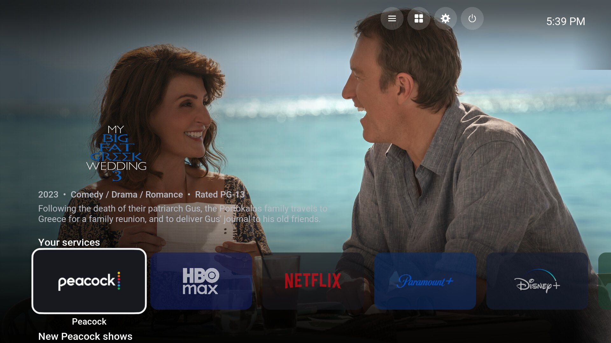</a>

> **Status: finished, and not maintained.** I built Backlot for my own living room and it does what I wanted. I don't plan to do more work on it, take feature requests or fix bugs. It's GPL, so fork it and make it yours. Everything you need to build and test it is in this repo.

---

## Install

Requires **Kodi 21 (Omega)**. Newer versions haven't been tested.

1. In Kodi, go to **Settings > System > Add-ons** and turn on **Unknown sources**.
2. Get the repository zip using **either** of these:
   - **Settings > File manager > Add source** and enter `https://starslayer74.github.io/skin.backlot/`, **or**
   - download [`repository.backlot-1.1.0.zip`](docs/repository.backlot-1.1.0.zip) and copy it to your device.
3. **Add-ons > Install from zip file** and pick `repository.backlot-1.1.0.zip`.
4. **Add-ons > Install from repository > Backlot Repository > Look and feel > Skin > Backlot**.
5. Say yes when Kodi asks to switch skins. The setup walkthrough starts on its own.

Kodi installs **Backlot Helper**, **Backlot Sounds** and Kodi's official **Studio Icons – Coloured** pack automatically. TMDb Helper, PreShow Experience and a weather add-on are optional. Backlot offers to install each one when you need it.

---

## What it does

### Home screen
- **Art-first layout.** Each title is shown with its full-screen fanart, clearlogo, year, genres, rating and plot. The services sit along the bottom, like Android TV.
- **One tile per service.** The tiles show the real service logos on a tinted version of each brand color, so the logo stays readable. Choose **banners** (classic Android TV) or **circles** (newer Google TV).
- **Service names** can appear under every tile, under only the focused tile, or not at all.
- **Background art cycles** through a random mix of that service's shows and movies while a tile is focused.
- **Two rows per service**, such as *New Peacock shows* and *New Peacock movies*, sorted by date added.
- **Movies, Collections and TV Shows tiles** at the end. Movies and TV Shows hold your whole library; Collections lists every movie collection on its own and can be turned off. Movies and TV Shows have *Recently added* and *Continue watching* / *Shows in progress* rows (optional).
- **Weather** in the top-left corner (optional), using Multi Weather, Gismeteo or NOAA.
- **Top bar** with Manage services, Add-ons, Settings and Power.
- **Seven color themes:** Midnight (default), Charcoal, Crimson, Forest, Ocean, OLED Black and Royal.

### Services
- **Streaming presets:** Peacock, HBO Max, Netflix, Paramount+, Disney+, The CW, AMC+, UK, Prime Video, Apple TV+, Hulu / FX, Discovery+, Starz, PBS, Univision and Crunchyroll.
- **Networks:** NBC, CBS, ABC, FOX, Telemundo, A&E, History, Lifetime and MGM+, plus BBC, ITV, Channel 4, Channel 5 and Sky under UK. Each network can have its own tile, stay only inside its streaming service (NBC in Peacock, CBS in Paramount+, ABC in Disney+, FOX, A&E, History and Lifetime in Hulu, MGM+ in Prime Video), or both. Both is the default. Network and niche-service tiles only appear once your library has something from them, and FOX only matches FOX itself, not 20th Century Fox.
- **Presets include the studios each company owns.** For example, Paramount Pictures, Nickelodeon and Comedy Central go to Paramount+. Warner Bros., New Line, DC and Adult Swim go to HBO Max. Universal, Focus, DreamWorks and Illumination go to Peacock. MGM and United Artists go to Prime Video.
- **Collections stay together.** A collection goes under the service that holds most of its movies, so every Blade or Alien film sits in one place even when their studios differ (can be turned off).
- **Hulu inside Disney+** and **Discovery+ inside HBO Max** are on by default, since that's where those catalogs now live in the US. You can also give either one its own tile or leave it out.
- **Custom services:** name it, pick its studios and networks from a list of the ones in your library (with title counts) or type them, choose a color, and set a logo or your own full banner or circle art.
- **Studios report:** lists every studio or network in your library that no service claims, with a title count for each. One click makes that studio its own service or adds it to an existing one.
- **Arrange home tiles:** an on-screen reorder screen for the services and the Movies, Collections and TV Shows tiles. Pick a tile up, move it left or right, and drop it.
- **Open button:** each service page has a button that launches the real service. It opens the Android TV app on Android boxes, the website everywhere else, or a program you choose on a PC. You can change what it opens (or hide it) per service in Manage services, and per network in Manage services > Networks. UK is a catch-all and has no Open button; BBC, ITV, Channel 4, Channel 5 and Sky open their own apps.
- **Export / import** your service setup as `backlot-services.json`, or reset everything to defaults.

### Service pages
- Selecting a tile opens a hub with that service's logo, **TV Shows** and **Movies** buttons, the **Open** button and both "New" rows.

### Library views
- **TV shows:** wide banner grid or posters.
- **Movies:** one row of large posters with the clearlogo, details and fanart above it.
- **Letter jump:** press Down on the movie row (or Right on the TV banners) for a # / A–Z bar. The focused title's letter is lit; pick a letter to jump straight to it.
- **Collections:** movie sets show as a single tile and open to their movies. Collection art is read from tinyMediaManager's `movieset-poster.jpg`, `movieset-clearlogo.png` and other `movieset-*` files next to your movies. Kodi ignores those files on its own.
- **Episodes, modern (default):** seasons down the left, episodes on the right with a thumbnail, date, runtime and description, like Netflix today.
- **Episodes, classic (option):** one row of large thumbnails with a season switcher above it.
- Android TV-style list defaults: no `..` parent item, no "All seasons" entry, and Back from a Backlot library view always ends on the home screen, never Kodi's Videos menu (opening Videos yourself to add sources or browse files still works normally).

### Info screens
- Clearlogo, details, director/studio/rating line, tagline and plot over full-screen fanart.
- **Cast row** with round photos.
- **More like this**, built from your own library. It scores shared genres, collection, director, studio and era.
- **Actor filmography from your library**, or, with TMDb Helper, full actor pages with photo and biography.
- Optional **"show everything" mode** (needs TMDb Helper). Similar titles and filmographies come from TMDb. Titles you own get an **In your library** pill. Titles you don't own show **where to watch** them, with provider logos.
- **PreShow Experience** support. A **PreShow** button sits next to Play, with an option to make PreShow the default. Backlot can install PreShow Experience from preshowmedia.com for you.

### Playback
- **Paused info screen.** Three seconds after you pause, the picture dims and the clearlogo, episode or tagline, details, plot and time left take over the screen, like Netflix and Google TV. It can be turned off in settings.
- **Chapters on the progress bar.** Chapter marks on the bar and the current chapter's name next to the time.
- **Subtitle and audio on the controls.** The OSD shows what's on now (for example "Off" and "ENG 5.1") on those buttons, plus time left and the end time.
- **Up Next card.** Near the end of an episode, a Backlot-styled card shows the next one with a countdown, Play now and Close. Uses the Up Next add-on, which Backlot can install for you.

### Setup and settings
- **First-run walkthrough** of 14 steps. Each choice shows a preview picture: tile style, names, color theme, services, networks, Hulu/Discovery+, episode layout, collections, Movies/TV tiles, TMDb Helper, PreShow, Up Next, similar titles, weather and sounds.
- **Backlot settings screen** (Settings > Backlot skin). Every setup answer can be changed here, with a help panel for each option.
- **File manager** in Settings for adding sources and copying, moving, renaming or deleting files.
- **Original navigation sounds**, with an option to use Kodi's sounds or none.
- **Check for Backlot updates** button.

---

## Screenshots

Captured from a test Kodi with a real library. Click any thumbnail for full size.

### Home
| | | |
|---|---|---|
| [](screenshots/full/20-home-banners-peacock.jpg)<br>Banners, Peacock | [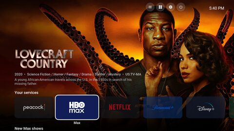](screenshots/full/21-home-banners-max.jpg)<br>HBO Max | [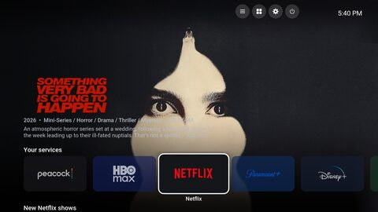](screenshots/full/22-home-banners-netflix.jpg)<br>Netflix |
| [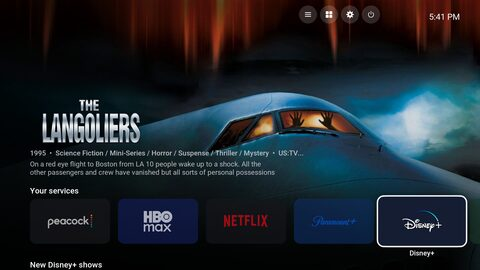](screenshots/full/23-home-banners-disney.jpg)<br>Disney+ | [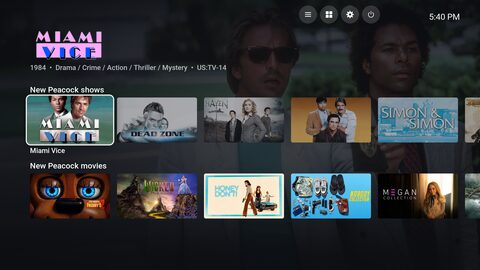](screenshots/full/24-home-rows-shows.jpg)<br>New shows row | [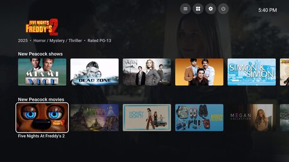](screenshots/full/25-home-rows-movies.jpg)<br>New movies row |
| [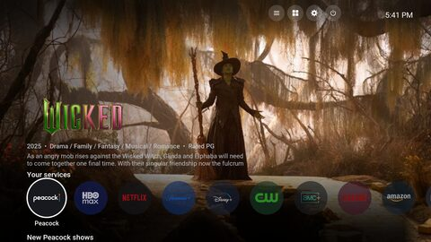](screenshots/full/29-home-circles.jpg)<br>Circles | [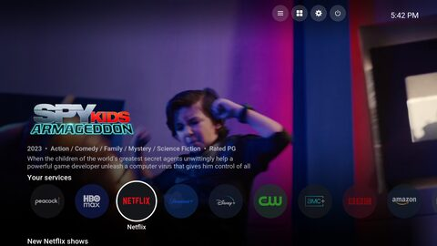](screenshots/full/30-home-circles-netflix.jpg)<br>Circles, Netflix | [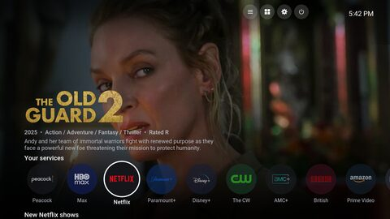](screenshots/full/31-home-circles-labels-all.jpg)<br>Circles, every name shown |
| [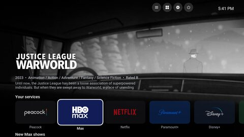](screenshots/full/27-home-labels-all.jpg)<br>Banners, every name shown | [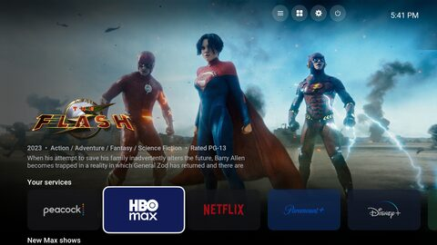](screenshots/full/28-home-labels-off.jpg)<br>Names off | [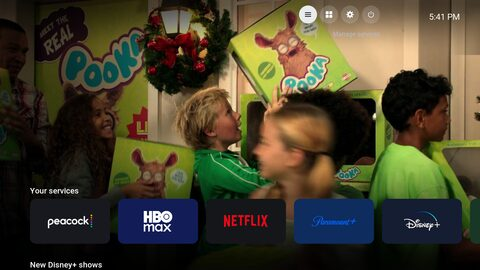](screenshots/full/26-home-topbar.jpg)<br>Top bar |
| [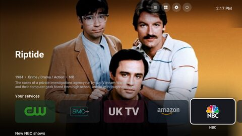](screenshots/full/23c-home-network-nbc.jpg)<br>A network tile (NBC) | [](screenshots/full/23d-home-uktv.jpg)<br>UK | |
| [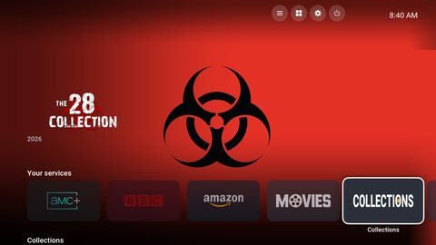](screenshots/full/25d-home-collections-tile.jpg)<br>Collections tile | [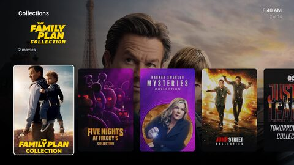](screenshots/full/52-library-collections.jpg)<br>Collections | |
| [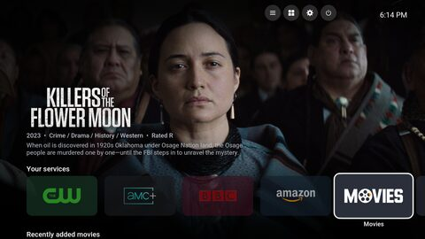](screenshots/full/25b-home-movies-tile.jpg)<br>Movies tile | [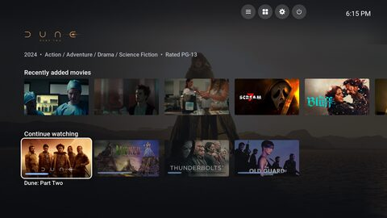](screenshots/full/25c-home-continue-watching.jpg)<br>Continue watching | [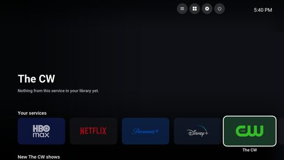](screenshots/full/23b-home-empty-service.jpg)<br>A service with nothing yet |

### Service page
| | |
|---|---|
| [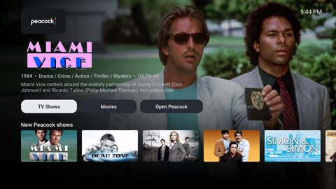](screenshots/full/40-hub-peacock-shows.jpg)<br>Hub | [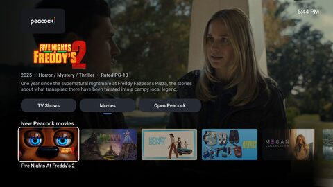](screenshots/full/42-hub-peacock-row.jpg)<br>Hub rows |

### Library
| | | |
|---|---|---|
| [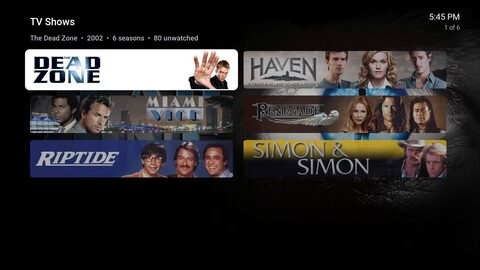](screenshots/full/44-library-shows-banners.jpg)<br>Shows, banners | [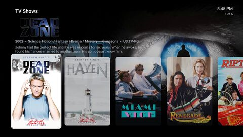](screenshots/full/45-library-shows-posters.jpg)<br>Shows, posters | [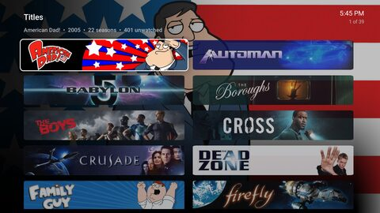](screenshots/full/46-library-all-shows.jpg)<br>All TV shows |
| [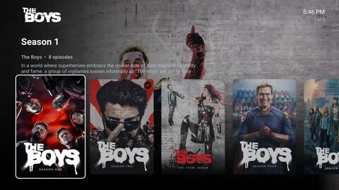](screenshots/full/47-library-seasons.jpg)<br>Seasons | [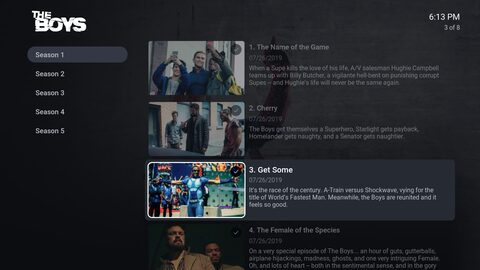](screenshots/full/48-library-episodes.jpg)<br>Episodes | [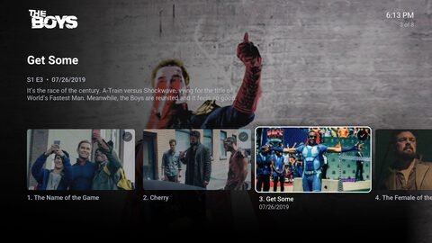](screenshots/full/49-library-episodes-classic.jpg)<br>Episodes, classic |
| [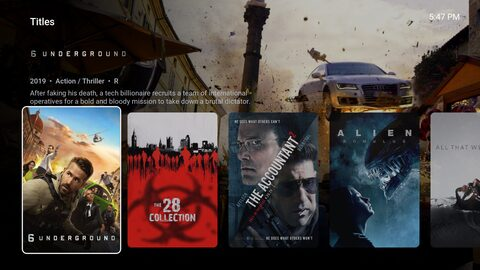](screenshots/full/50-library-movies.jpg)<br>Movies | [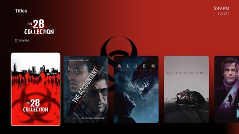](screenshots/full/50c-library-movies-collection-tile.jpg)<br>A collection tile | [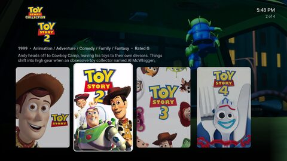](screenshots/full/51-library-collection.jpg)<br>Inside a collection |

### Info screens
| | | |
|---|---|---|
| [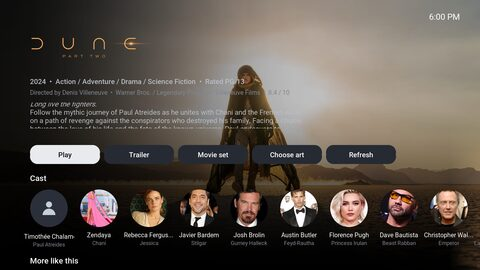](screenshots/full/60-info-movie.jpg)<br>Movie | [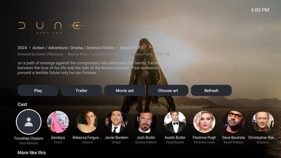](screenshots/full/61-info-movie-cast.jpg)<br>Cast | [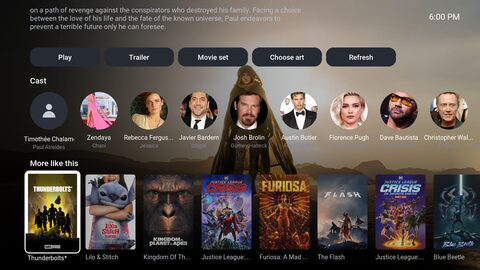](screenshots/full/62-info-movie-morelikethis.jpg)<br>More like this |
| [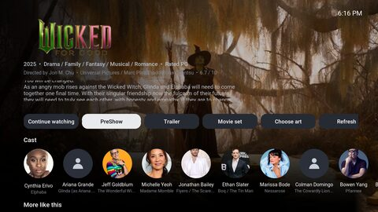](screenshots/full/66-info-movie-preshow.jpg)<br>PreShow button | [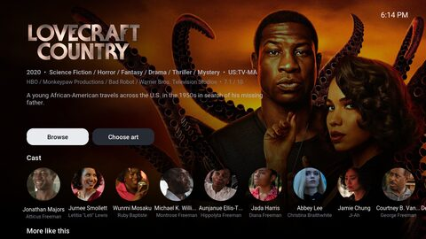](screenshots/full/64-info-tvshow.jpg)<br>TV show | [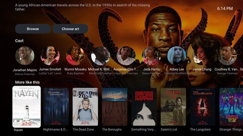](screenshots/full/65-info-tvshow-morelikethis.jpg)<br>TV show, more like this |

### Playback
| | |
|---|---|
| [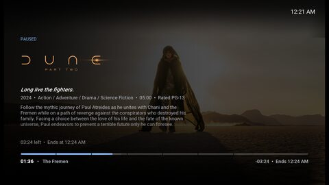](screenshots/full/95-playback-paused.jpg)<br>Paused info screen | [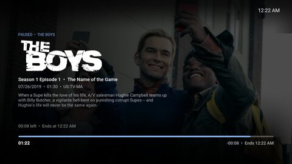](screenshots/full/95c-episode-paused.jpg)<br>Paused, episode |
| [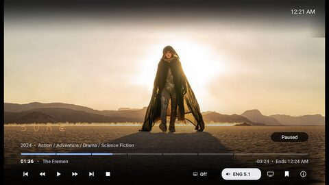](screenshots/full/96b-playback-osd-audio.jpg)<br>Controls, chapters and audio | [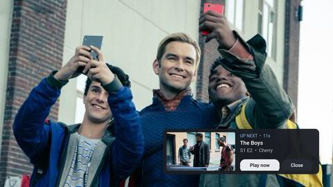](screenshots/full/97-playback-upnext.jpg)<br>Up Next card |

### Setup walkthrough
| | | |
|---|---|---|
| [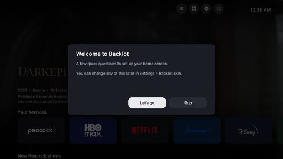](screenshots/full/00-setup-welcome.jpg)<br>Welcome | [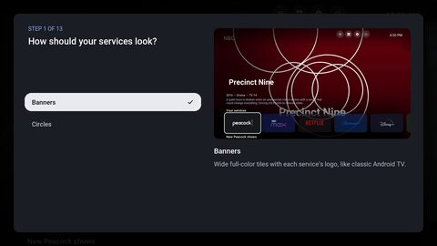](screenshots/full/01-setup-style.jpg)<br>1. Tile style | [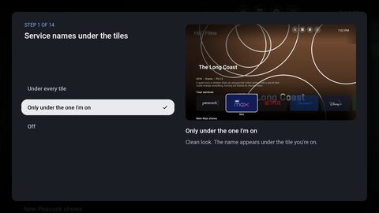](screenshots/full/02-setup-labels.jpg)<br>Names under tiles |
| [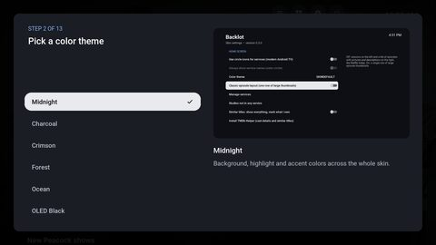](screenshots/full/03-setup-theme.jpg)<br>2. Color theme | [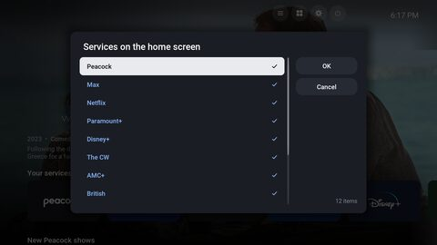](screenshots/full/04-setup-services.jpg)<br>3. Services | [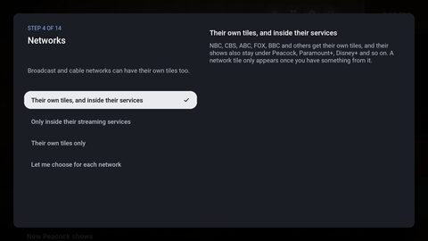](screenshots/full/04b-setup-networks.jpg)<br>4. Networks |
| [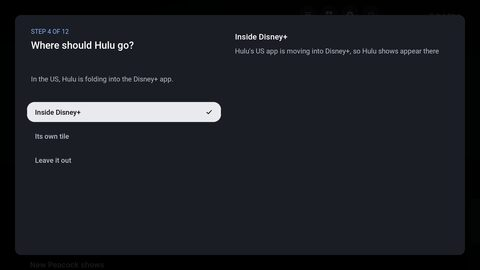](screenshots/full/05-setup-hulu.jpg)<br>5. Hulu | [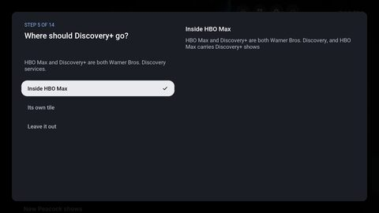](screenshots/full/06-setup-discovery.jpg)<br>5. Discovery+ | [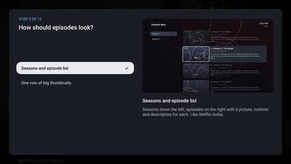](screenshots/full/07-setup-episodes.jpg)<br>6. Episodes |
| [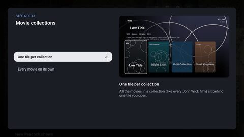](screenshots/full/08-setup-collections.jpg)<br>7. Collections | [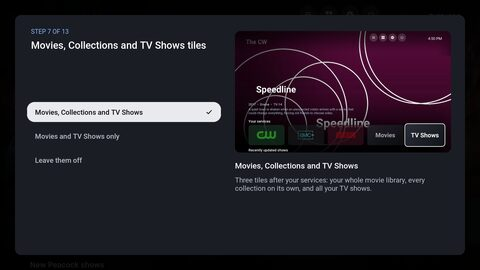](screenshots/full/09-setup-fallbacks.jpg)<br>8. Movies / Collections / TV tiles | [](screenshots/full/10-setup-tmdbhelper.jpg)<br>9. TMDb Helper |
| [](screenshots/full/11-setup-preshow.jpg)<br>10. PreShow | [](screenshots/full/11b-setup-upnext.jpg)<br>11. Up Next | [](screenshots/full/12-setup-similar.jpg)<br>12. More like this |
| [](screenshots/full/13-setup-weather.jpg)<br>13. Weather | [](screenshots/full/14-setup-sounds.jpg)<br>14. Sounds | [](screenshots/full/15-setup-done.jpg)<br>Done |

### Settings and service management
| | | |
|---|---|---|
| [](screenshots/full/68-settings-hub.jpg)<br>Settings | [](screenshots/full/69-file-manager.jpg)<br>File manager | [](screenshots/full/71c-settings-player.jpg)<br>Player settings |
| [](screenshots/full/70-settings.jpg)<br>Backlot settings | [](screenshots/full/71-settings-lower.jpg)<br>More settings | [](screenshots/full/81b-arrange-services-moving.jpg)<br>Arrange services |
| [](screenshots/full/82-manage-services.jpg)<br>Manage services | [](screenshots/full/84-edit-service-max.jpg)<br>Edit a service | [](screenshots/full/85-edit-studios.jpg)<br>Studios and networks |
| [](screenshots/full/86-edit-open-button.jpg)<br>Open button | [](screenshots/full/89-studios-report.jpg)<br>Studios report | [](screenshots/full/90-studios-report-assign.jpg)<br>Give a studio a home |
| [](screenshots/full/91b-manage-networks.jpg)<br>Networks | [](screenshots/full/91c-network-nbc.jpg)<br>One network's options | |
| [](screenshots/full/91-manage-hulu.jpg)<br>Where Hulu goes | [](screenshots/full/92-weather-provider.jpg)<br>Weather source | [](screenshots/full/80-sounds-picker.jpg)<br>Sounds |

### Color themes
| | | |
|---|---|---|
| [](screenshots/full/72-theme-charcoal.jpg)<br>Charcoal | [](screenshots/full/73-theme-crimson.jpg)<br>Crimson | [](screenshots/full/74-theme-forest.jpg)<br>Forest |
| [](screenshots/full/75-theme-ocean.jpg)<br>Ocean | [](screenshots/full/76-theme-oled-black.jpg)<br>OLED Black | [](screenshots/full/77-theme-royal.jpg)<br>Royal |

All of the screenshots, including a few more dialogs, are in [`screenshots/full`](screenshots/full).

---

## Design notes

- **Grouped by who made it, not who streams it today.** Streaming catalogs change every month, but the studio in your NFO files doesn't. Backlot matches against the `studio` field Kodi already has. A title belongs to a service when any of its studios contains one of that service's names, so "Warner Bros. Pictures" and "Warner Bros. Television" both match "Warner Bros.". Anything left over goes to the Movies / TV Shows tiles, and the studios report shows you what's there.
- **Smart playlists do the work.** Backlot Helper writes one set of `.xsp` smart playlists per service (all shows, all movies, newest shows, newest movies). The skin just points at them, so the lists are as fast as any normal Kodi library view and update after every library scan.
- **The skin and the helper are separate.** The skin is XML only. The helper (`script.backlot.helper`) holds the service list, writes the playlists, publishes the home tiles as window properties, and runs the setup, report and management dialogs. You can change service logic without touching the skin's layout.
- **Logos come from Kodi's official coloured studio pack** and sit on a darkened version of each brand color, so a green logo on a green tile still reads. To use your own logo, drop `<service id>.png` into `addon_data/script.backlot.helper/logos/`.
- **Android TV conventions:** no `..` items and no "All seasons" entry.
- **Readable from the couch.** The type is Roboto, with large sizes and high-contrast focus states.
- **Works without TMDb Helper.** More like this, cast and filmographies all work from your local library. TMDb Helper adds actor bios, full filmographies and where-to-watch, but nothing depends on it.

---

## Building it yourself

```
python3 tools/build_repo.py dist/local "http://localhost:8765/" script.backlot.helper skin.backlot resource.uisounds.backlot vendor/repository.jurialmunkey
```

That writes a Kodi repository to `dist/local/repo`. On Windows, `tools/Start Backlot Repo.bat` serves it at `http://localhost:8765/` so a Kodi on the same computer can install and update from it. Point the build at your own URL to host a fork. The published repo in [`docs/`](docs) is built the same way, with this repo's `raw.githubusercontent.com` address.

`tools/kodi_test/` holds the headless test setup used for development and these screenshots: Kodi under Xvfb, driven over JSON-RPC (`kodictl.py`, `shoot.py`). Its `sync.sh` copies the add-ons into a test profile and starts Kodi.

### Layout
| Folder | What it is |
|---|---|
| `skin.backlot/` | The skin (XML, colors, fonts, media) |
| `script.backlot.helper/` | Helper add-on: services, playlists, setup, dialogs (Python) |
| `resource.uisounds.backlot/` | Navigation sounds |
| `repository.backlot/` | The repository add-on |
| `vendor/repository.jurialmunkey/` | jurialmunkey's repository, included so TMDb Helper can be installed in one step |
| `docs/` | The built Kodi repository served to users |
| `tools/` | Build script, local repo server, test harness |

---

## Credits and license

- Skin and helper: GPL-2.0-or-later. See [LICENSE](LICENSE).
- Navigation sounds: CC0-1.0.
- Roboto font: Apache-2.0.
- Studio logos: Kodi's *Studio Icons – Coloured* resource pack (Team Kodi).
- Optional integrations: [TMDb Helper](https://github.com/jurialmunkey/plugin.video.themoviedb.helper) by jurialmunkey, PreShow Experience from preshowmedia.com.
- Service names and logos belong to their owners. Backlot isn't affiliated with any streaming service.

Built by **starslayer74** for personal use. Fork it, rename it, rip it apart. Have fun.
